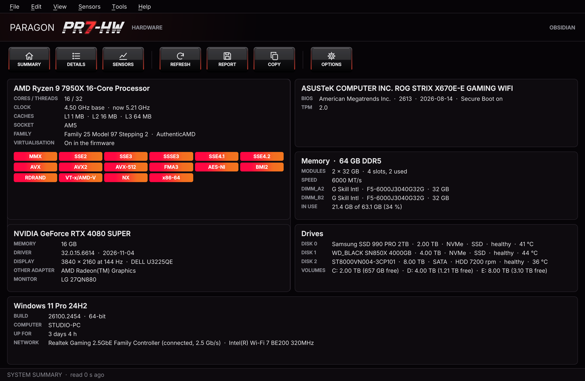
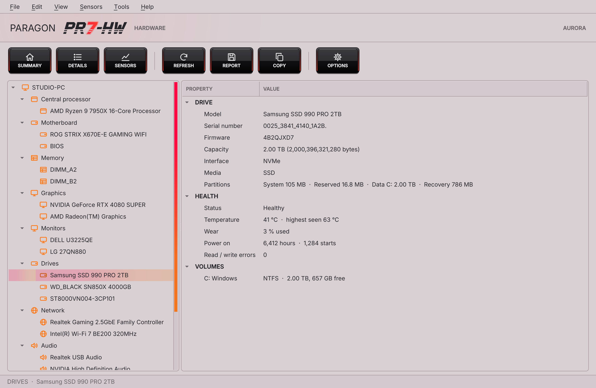
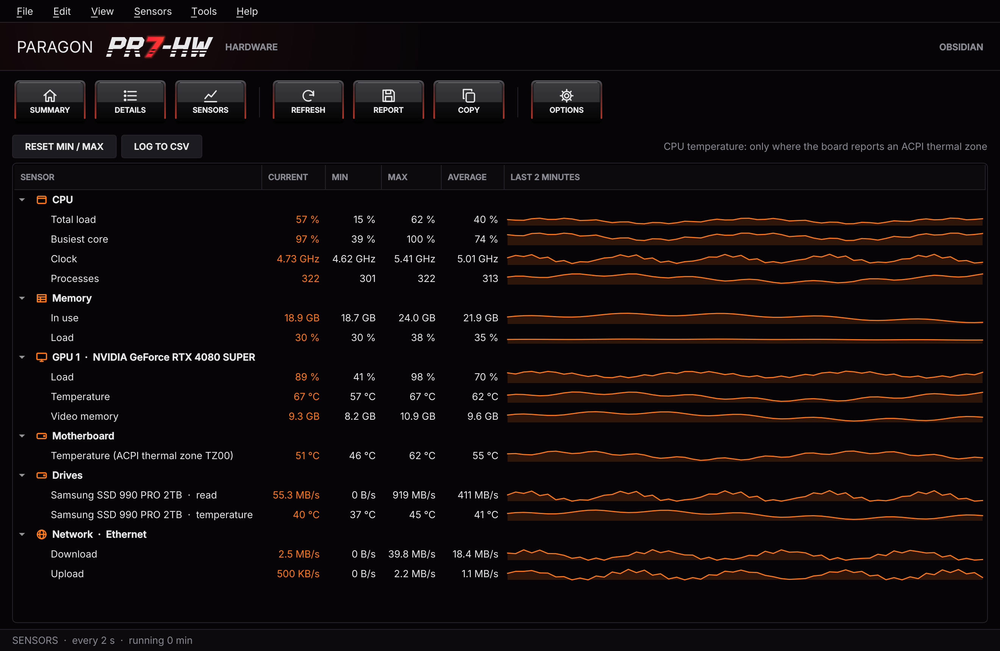

# Paragon PR7-HW

Hardware information, the way **HWiNFO** and **CPU-Z** show it, in the Paragon family look (PR7-Z ... PR7-UN,
PR7-LN). Python and PySide6.

## What it does

- **System Summary:** one page with:
  - the CPU: cores and threads, clocks, caches, socket, and its instruction sets lit when supported;
  - the motherboard, BIOS, Secure Boot and TPM;
  - each memory module with its type and speed;
  - the graphics card with its real video memory (not Windows' 4 GB cap) and the monitors;
  - every drive with its bus, health and temperature;
  - Windows, its build and how long it has been up, and the network adapters.
- **Details:** a tree of every device (CPU, motherboard, memory, graphics, monitors, drives, network, audio, USB,
  battery, Windows) with its properties. Drives show their S.M.A.R.T. health: wear, power-on hours, errors,
  temperature.
- **Sensors:** live readings every 2 seconds (or 1, 5, 10), each with Current / Min / Max / Average and a graph of
  the last two minutes. Covers:
  - CPU load and clock, memory and page file;
  - each drive's and network adapter's speed;
  - GPU load and video memory (the figures Task Manager shows);
  - an NVIDIA card's temperature, power and fan through nvidia-smi;
  - drive temperatures (as administrator) and ACPI thermal zones;
  - battery charge.

  Reset Min / Max, and Log to CSV.
- **Report** saves everything as text; **Copy** copies the selected property, reading or page.
- **As Admin** restarts PR7-HW with Windows' prompt: drive health and temperatures need administrator rights.

**No kernel driver.** HWiNFO reads CPU temperature, power and fan speeds through its own driver. PR7-HW reads only
what Windows itself provides, so nothing is installed into Windows and Defender has nothing to flag. A CPU
temperature shows only where the motherboard reports an ACPI thermal zone.

## Building

`pip install -r requirements.txt -r requirements-dev.txt`, `python -m pytest`, `pyinstaller pr7hw.spec`, then Inno Setup:
`iscc /DAppVersion=x.y.z installer\pr7hw.iss`.
